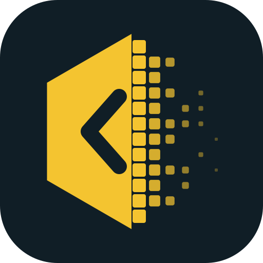

<div align="center">



# Reverso: Native reverse engineering toolkit

<p><b>Satu CLI dan satu MCP server untuk reverse engineering statis.<br/>
Binary, bundle JavaScript dan website, dianalisis secara offline, tanpa
dependensi.</b></p>

<a href="https://github.com/nekonaru/reverso/releases/latest"></a>
<a href="https://github.com/nekonaru/reverso/actions/workflows/ci.yml"></a>
<a href="https://nodejs.org/"></a>
<a href="https://github.com/nekonaru/reverso"></a>
<a href="LICENSE"></a>

</div>

<br />

[English](README.md) | **Bahasa Indonesia**

> [!NOTE]
> Gunakan Reverso hanya pada berkas, aplikasi dan website yang memang boleh kamu analisis.

---

## Daftar Isi

- [Tentang](#tentang)
- [Fitur](#fitur)
- [Kebutuhan](#kebutuhan)
- [Instalasi](#instalasi)
- [Penggunaan](#penggunaan)
- [Struktur Proyek](#struktur-proyek)
- [Pengembangan](#pengembangan)
- [Pengujian](#pengujian)
- [Keamanan](#keamanan)
- [Continuous Integration](#continuous-integration)
- [FAQ](#faq)
- [Penulis](#penulis)
- [Lisensi](#lisensi)

---

## Tentang

Reverso adalah toolkit reverse engineering yang berjalan native, untuk developer,
peneliti keamanan dan tooling agentic. Reverso mentriase binary yang tidak
dikenal, menginventarisasi bundle JavaScript, dan mirror website untuk
analisis offline, dari satu perintah atau satu MCP server. Semuanya berjalan
lokal: tanpa Ghidra, Hopper, IDA, Python atau license server untuk analyzer
bwaan, dan paketnya dikirim dengan nol dependensi runtime. Kunjungi
[project site](https://nekonaru.github.io/reverso/) untuk ikhtisar singkat.

> _"Analisis apa pun, tanpa instalasi apa pun."_

---

## Fitur

### Analyzer

| Fitur | Deskripsi |
| --- | --- |
| **Laporan triase lengkap** | `reverso analyze <file>`: hash, ukuran, entropy, format, strings, layout, hardening, daftar arsip dan analisis JavaScript dalam satu laporan, sebagai JSON atau Markdown |
| **Deteksi format** | Deteksi magic byte untuk ELF, PE, Mach-O, ZIP (APK/IPA/JAR), WASM, DEX, PDF, PCAP dan lainnya |
| **Struktur binary** | Struktur ELF, PE dan Mach-O: section, program header, impor, ekspor, entropy per section dan PE import hash (`imphash`) |
| **Cek hardening** | PIE, NX stack, stack canary, RELRO dan FORTIFY untuk ELF; ASLR, NX compat, Control Flow Guard, high entropy VA dan Authenticode untuk PE |
| **Analisis entropy** | Entropy Shannon dengan deteksi region entropy tinggi untuk konten yang dipack atau dienkripsi |
| **Intelijen strings** | String ASCII dan UTF-16LE, dikategorikan sebagai URL, IPv4, email, path, JWT, AWS key, GitHub token, Slack token, Google API key, private key dan assigned secret |
| **Analisis JavaScript** | Deteksi minifikasi, skor obfuscation dengan indikator, fingerprint framework (webpack, React, Vue, Angular, Next.js, Vite, Svelte, jQuery), referensi source map, ekstraksi URL dan endpoint API, secret scanning |
| **Inventaris arsip** | Daftar entri ZIP/APK/IPA/JAR dengan ukuran, metode kompresi, flag enkripsi, deteksi tipe dan penandaan entri mencurigakan |
| **Sinyal packer** | Deteksi tanda tangan dan stub UPX, plus heuristik region entropy tinggi |

### Inspector dan utilitas

| Fitur | Deskripsi |
| --- | --- |
| **Triase direktori** | `reverso scan <dir>` triage rekursif seluruh file (format, entropy, SHA-256, sinyal packer) dengan rincian per format |
| **Diff binary** | `reverso diff <a> <b>`: hash, entropy, ukuran, trait hardening (PIE, RELRO, canary, ASLR, CFG, ...), section, impor, ekspor dan kategori string |
| **Pencarian byte hex** | `reverso find-bytes <file> <hex>`: pola `4d 5a ?? 60` dengan wildcard `??`, plus hex dump klasik lewat `reverso hex` |
| **Inspector WebAssembly** | `reverso wasm <file>`: section, tipe, impor, ekspor, jumlah function/table/memory/global dan section name |
| **Inspector DEX** | `reverso dex <file>`: jumlah di header, checksum, dan string table terkategori dari Android Dalvik Executable |
| **Inspector PCAP** | `reverso pcap <file>`: rincian protokol, top talker dan top port tujuan dari classic PCAP capture |
| **Decoder JWT** | `reverso jwt <token>`: header, payload, hitung mundur expiry dan peringatan keamanan (signature tidak pernah diverifikasi) |

### Mirror website

| Fitur | Deskripsi |
| --- | --- |
| **Mirror same-origin** | `reverso site <url>` mirror HTML, CSS dan asset secara lokal dengan rewrite link ke relatif |
| **Penjaga keamanan** | Menolak alamat loopback, privat, link-local dan reserved (IP literal dan jawaban DNS) kecuali `--allow-private` diberikan |
| **Batas resource** | Membatasi jumlah halaman, kedalaman, ukuran file dan total byte; menolak redirect lintas origin |

### Otomasi

| Fitur | Deskripsi |
| --- | --- |
| **MCP server** | `reverso mcp` mengekspos setiap analyzer sebagai tool Model Context Protocol lewat stdio (protokol `2025-06-18`) |
| **Ramah script** | Output JSON secara default, laporan Markdown dengan `--format md`, tulis ke file dengan `--out` |
| **Self-check lingkungan** | `reverso doctor` memvalidasi runtime sebelum kamu bergantung padanya |

---

## Kebutuhan

| Dependensi | Versi Minimum | Catatan |
| --- | --- | --- |
| **Node.js** | `^22.23.4`, `^24.22.1` atau `>=26.12.1` | ESM, TypeScript strict, nol dependensi runtime |

Tidak dibutuhkan toolchain C/C++, Python, Java atau tool analisis eksternal.

> [!TIP]
> Kamu bisa menjalankan CLI langsung dari repo tanpa menginstalnya secara global.
> Lihat [Instalasi](#instalasi), Opsi B.

### Belum pernah pakai terminal? Mulai dari sini

<details>
<summary><b>Cara membuka terminal</b></summary>

1. **Windows:** tekan `Win + R`, ketik `wt` atau `powershell`, tekan Enter.
2. **macOS:** tekan `Cmd + Space`, ketik `Terminal`, tekan Enter.
3. **Linux:** tekan `Ctrl + Alt + T`, atau cari `Terminal` di menu aplikasi.

</details>

---

## Instalasi

### Opsi A: Perintah global (npm link)

1. Pasang Git dan Node.js (lihat detail Git di bawah).
2. Clone, build dan link:

   ```bash
   git clone https://github.com/nekonaru/reverso.git
   cd reverso
   npm ci
   npm run build
   npm link
   ```

   > [!IMPORTANT]
   > `npm run build` harus selesai tanpa error. Jika ada type error,
   > berhenti dan buka issue, jangan jalankan binary-nya.

3. Verifikasi: `reverso doctor`

<details>
<summary><b>Saya sudah punya Git</b></summary>

Lewati langkah Git di atas. `git --version` seharusnya menampilkan versi.

</details>

<details>
<summary><b>Saya belum punya Git</b></summary>

Unduh arsip source dari
[GitHub](https://github.com/nekonaru/reverso/archive/refs/heads/main.zip), unzip,
lalu jalankan `npm ci`, `npm run build` dan `npm link` di folder hasil ekstrak.

</details>

### Opsi B: Jalankan dari repo tanpa instalasi

```bash
git clone https://github.com/nekonaru/reverso.git
cd reverso
npm ci
npm run build
node dist/cli.js doctor
```

Gunakan `node dist/cli.js <perintah>` di mana pun kamu memakai `reverso <perintah>`.

---

## Penggunaan

### Jalankan pertama kali

1. Cek runtime: `reverso doctor`
2. Analisis sebuah berkas: `reverso analyze ./some-file.bin`
3. Arahkan MCP client kamu ke `reverso mcp` (lihat di bawah)

> [!NOTE]
> Reverso itu statis sepenuhnya. Ia tidak pernah mengeksekusi berkas yang kamu analisis.

### Penggunaan sehari-hari

- `reverso analyze ./target.bin` untuk laporan triase lengkap (tambahkan `--format md --out report.md` untuk Markdown)
- `reverso scan ./samples --max-files 500` untuk triase seluruh direktori berisi file yang tidak dikenal
- `reverso diff ./versi-lama.bin ./versi-baru.bin` untuk melihat persis apa yang berubah di antara dua build
- `reverso find-bytes ./firmware.bin "7f 45 4c 46"` untuk mencari pola byte dengan wildcard
- `reverso hex ./mystery.bin --offset 0 --length 256` untuk hex dump dengan offset
- `reverso pcap ./capture.pcap` untuk statistik protokol dan top talker
- `reverso jwt ./token.txt` untuk mendekode claims dan expiry sebuah token
- `reverso format ./mystery.bin` untuk mengidentifikasi berkas
- `reverso layout ./target.elf` dan `reverso hardening ./win32.exe` untuk struktur dan proteksi binary
- `reverso strings ./firmware.bin --min-length 6` untuk strings terkategori
- `reverso js ./app.min.js` untuk inventaris endpoint dan secret di bundle web
- `reverso dex ./classes.dex` untuk memeriksa string table Android DEX
- `reverso wasm ./module.wasm` untuk memeriksa modul WebAssembly
- `reverso site https://example.com --out ./mirror` untuk mirror website offline
- `reverso capabilities` untuk daftar semua analyzer dan MCP tool

### Pakai Reverso dari MCP client

`reverso mcp` berbicara Model Context Protocol lewat stdio (protokol `2025-06-18`).
Tambahkan ke konfigurasi client kamu:

```json
{
  "mcpServers": {
    "reverso": {
      "command": "reverso",
      "args": ["mcp"]
    }
  }
}
```

Tool yang diekspos: `reverso_analyze`, `reverso_strings`, `reverso_entropy`,
`reverso_format`, `reverso_layout`, `reverso_hardening`, `reverso_archive_list`,
`reverso_js_analyze`, `reverso_scan`, `reverso_diff`, `reverso_find_bytes`,
`reverso_wasm`, `reverso_dex`, `reverso_hex`, `reverso_pcap` dan `reverso_jwt`.

---

## Struktur Proyek

```text
reverso/
├── src/
│   ├── core/         # deteksi format, entropy, hash, strings, orkestrasi, report
│   ├── binary/       # parser ELF / PE / Mach-O dan cek hardening
│   ├── archive/      # parser keluarga ZIP (deteksi APK/IPA/JAR)
│   ├── js/           # analisis bundle JavaScript
│   ├── web/          # mirror website (same origin, penjaga alamat privat)
│   ├── mcp/          # MCP stdio server
│   ├── doctor.ts     # self-check lingkungan
│   ├── index.ts      # API publik
│   └── cli.ts        # dispatcher perintah (lapisan tipis di atas engine)
├── tests/            # unit dan integration test (vitest)
├── docs/
│   ├── specs/        # spesifikasi yang bisa diuji (done criteria)
│   └── brand.md      # penggunaan logo dan warna
├── assets/logo/      # file logo final (mark, lockup, ikon)
├── scripts/verify.mjs# pipeline verifikasi lokal
├── README.md         # versi Inggris
└── README.id.md      # file ini
```

---

## Pengembangan

### Menambah analyzer baru

1. Tulis analyzer di `src/` (fungsi murni, hindari I/O sebisa mungkin).
2. Daftarkan di `src/core/analyze.ts` dan ekspor dari `src/index.ts`.
3. Tambahkan perintah CLI di `src/cli.ts` dan MCP tool di `src/mcp/server.ts`.
4. Tambahkan test di `tests/` dan jalankan `node scripts/verify.mjs`.
5. Dokumentasikan perintah di kedua README dan spesifikasinya di `docs/specs/`.

### Menjalankan pipeline verifikasi

1. `node scripts/verify.mjs` (typecheck, test dengan coverage, build, audit).
2. Semuanya harus hijau sebelum pull request dibuka.
3. CI menjalankan pipeline yang sama di Ubuntu dan Windows, Node 22 dan 24.

### Memotong rilis

1. Naikkan versi di `package.json` (dan konstanta banner CLI) sebagai `MAJOR.MINOR.PATCH`.
2. Perbarui `CHANGELOG.md` dan `CHANGELOG.id.md` dengan section yang sama seperti release notes.
3. Buka pull request; merge setelah CI hijau.
4. Tag `vX.Y.Z` pada commit hasil merge dan push tag-nya.
5. Terbitkan GitHub Release dengan catatan bilingual (judul `Project vX.Y.Z`).

> [!WARNING]
> `dist/` dibuat oleh `npm run build`. Jangan pernah edit isi `dist/` dengan
> tangan dan jangan commit file di dalamnya.

---

## Pengujian

```bash
npm ci
npm test                  # test suite
npm run test:coverage     # test dengan threshold coverage
node scripts/verify.mjs   # pipeline penuh (typecheck, coverage, build, audit)
```

| Cek | Syarat |
| --- | --- |
| Unit dan integration test | Semua pass (149 test) |
| Line coverage | Minimal 70% |
| Branch coverage | Minimal 60% |
| Type check | `tsc --noEmit`, nol error |
| Audit dependensi | `npm audit --omit=dev --audit-level=high`, nol temuan |
| Secret scan | Job gitleaks di CI, nol temuan |

Linting adalah TypeScript compiler dalam strict mode (`strict`,
`noUncheckedIndexedAccess`, `exactOptionalPropertyTypes`). Tidak ada konfigurasi
linter terpisah secara desain.

---

## Keamanan

Reverso memproses berkas yang tidak dipercaya tanpa mengeksekusinya, membatasi
ukuran input (256 MiB untuk file, 64 MiB lewat MCP) dan menolak alamat jaringan
privat di web mirror secara default. Paket ini tidak punya dependensi runtime.
Dependensi production diaudit di CI pada setiap push, dan semua CI berjalan
dengan secret scan.

Menemukan vulnerability? Gunakan private vulnerability reporting di repositori
ini (tab Security, "Report a vulnerability"). Jangan buka issue publik untuk
laporan keamanan.

---

## Continuous Integration

| Workflow | Tujuan |
| --- | --- |
| `ci.yml` | Job verify (typecheck, test dengan coverage, build, audit) di Ubuntu dan Windows, Node 22 dan 24, plus secret scan gitleaks |

Branch protection pada `main` mewajibkan setiap check ini pass sebelum merge.
Rilis hanya dibuat dari `main` yang hijau setelah security gate selesai.

---

## FAQ

<details>
<summary><b>Apakah Reverso mengeksekusi binary yang dianalisis?</b></summary>

Tidak. Semua analisis bersifat statis. Tidak ada yang dimuat, dijalankan atau diemulasikan.

</details>

<details>
<summary><b>Bisakah decompile ke pseudocode?</b></summary>

Tidak. Reverso mentriase, menginventarisasi dan memberi skor. Untuk decompilation,
berikan berkasnya ke decompiler khusus; pakai Reverso untuk triase, ekstraksi dan pelaporan.

</details>

<details>
<summary><b>Apakah butuh koneksi internet?</b></summary>

Tidak untuk analisis. Test suite dan integration test mirror hanya bind ke
loopback saat development. Analisis itu sendiri tidak menyentuh jaringan sama sekali.

</details>

<details>
<summary><b>Kenapa `reverso analyze` menandai entropy tinggi?</b></summary>

Entropy tinggi (di atas sekitar 7 bit per byte) biasanya berarti konten yang
dikompresi, dienkripsi atau dipack. Periksa region yang dilaporkan dan sinyal
packer sebelum berasumsi malware.

</details>

<details>
<summary><b>Apakah Reverso sudah terbit di npm?</b></summary>

Belum. Install dari source seperti di Instalasi. Manifest paketnya sudah siap
untuk rilis; publikasi menunggu rilis stabil pertama.

</details>

<details>
<summary><b>Bagaimana hubungan Reverso dengan tool reverse engineering lain?</b></summary>

Reverso adalah proyek independen yang dibangun ulang dari studi terhadap
tooling yang tersedia secara publik. Tidak ada source code dari proyek lain
yang disertakan. Reverso melengkapi tool interaktif berat, bukan menggantikannya.

</details>

---

## Penulis

<div align="center">

| [](https://github.com/nekonaru) |
|:---:|
| **Nicolas Dwi Dharma** |
| [github.com/nekonaru](https://github.com/nekonaru) |

</div>

---

## Lisensi

Didistribusikan di bawah **MIT License**. Lihat [`LICENSE`](LICENSE) untuk informasi lebih lanjut.
